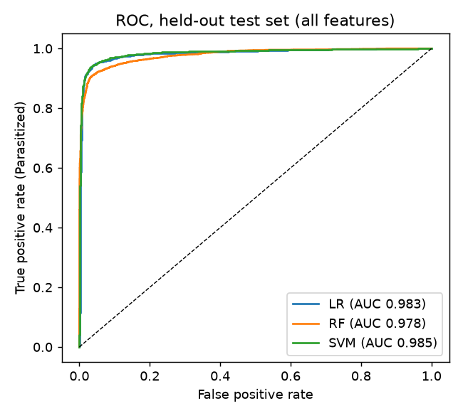
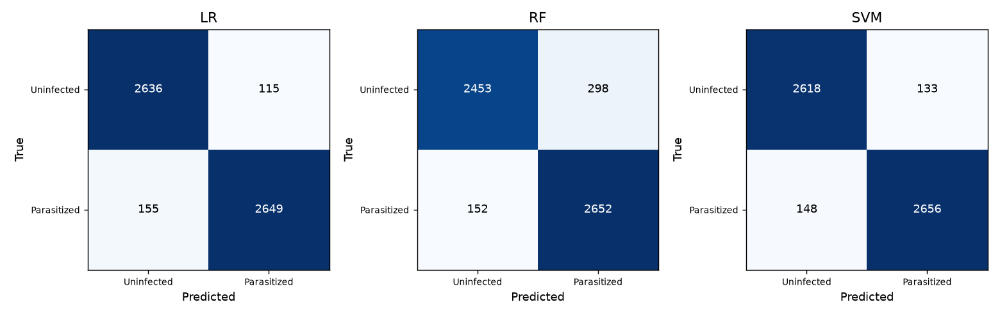
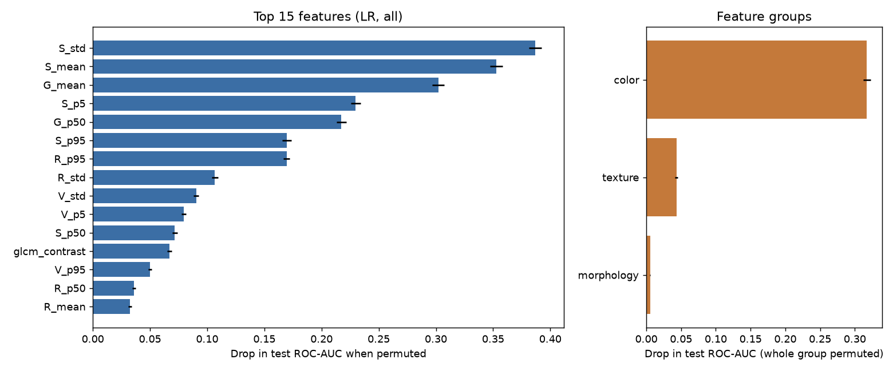
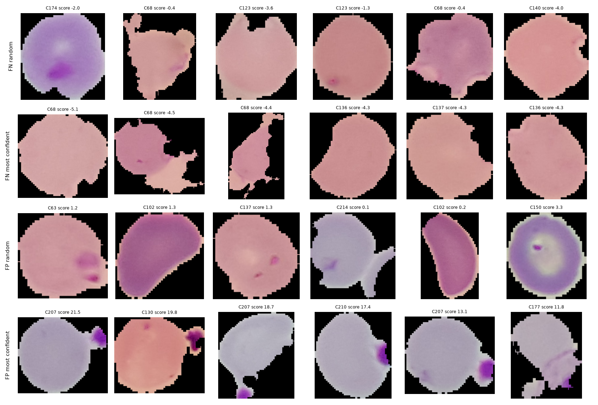

# Explainable Malaria Cell Detection with Classical Machine Learning

Can a computer tell malaria-infected red blood cells from healthy ones using simple, interpretable measurements instead of deep learning? This project classifies single-cell images from the NIH malaria dataset using **shape, color and texture features** with Logistic Regression, Random Forest and an SVM, then explains what the models rely on.

> Research and coursework project. Not validated for clinical use.

## Results (held-out test set: 5,555 cells from 40 slide codes)

| Model | Accuracy | Precision | Recall | F1 | ROC-AUC |
|---|---|---|---|---|---|
| Logistic Regression (primary) | 0.951 | 0.958 | 0.945 | 0.952 | 0.983 |
| SVM (RBF) | 0.949 | 0.952 | 0.947 | 0.950 | 0.985 |
| Random Forest | 0.919 | 0.899 | 0.946 | 0.922 | 0.978 |

Parasitized is the positive class. Full tables with confidence intervals are in `results/test_metrics_all.csv`.

**Color ablation** (same protocol, 27 color features removed): ROC-AUC falls from 0.983 to 0.936 (LR), 0.985 to 0.969 (SVM) and 0.978 to 0.963 (RF).

**Permutation importance** (LR, held-out set, AUC drop when a feature group is shuffled): color 0.317, texture 0.043, morphology 0.005. Saturation and green-channel statistics rank highest, consistent with Giemsa-stained parasites.

## Approach

- **Data:** 27,558 single-cell images (13,779 per class), already cut out on a black background.
- **Features (38):** 5 morphology (area and perimeter in pixels, circularity, eccentricity, solidity), 27 RGB/HSV color statistics, 6 GLCM texture descriptors. No image is resized.
- **Split:** stratified and grouped by the slide code in each filename (200 codes), frozen before modelling.
- **Tuning:** training data only, 5-fold grouped cross-validation, ROC-AUC.
- **Evaluation:** test set evaluated once. Ablation, importance and error analysis are diagnostic and were not used to retune.

## Limitations

- No official patient ID exists in this dataset. The filename code is an unverified proxy, so cells from one patient may still appear in both train and test.
- Masks are the dataset's own cutouts, so morphology describes those masks.
- GLCM texture uses grayscale intensity, so the no-color ablation still contains some intensity information.
- One dataset and site; errors cluster in a few slides.

## Reproduce

Python 3.13.2. Create a virtual environment, then `pip install -r requirements.txt` (exact versions in `requirements.lock.txt`). Download the [dataset](https://www.kaggle.com/datasets/iarunava/cell-images-for-detecting-malaria) into `data/raw/` so that exactly one `Parasitized` and one `Uninfected` folder exist there (remove the nested `cell_images/cell_images` copy). Then, from the project root:

    python -m src.inspect_data
    python -m src.sample_images
    python -m src.mask_check
    python -m src.make_split
    python -m src.extract_features
    python -m src.train_models all
    python -m src.evaluate all
    python -m src.train_models nocolor
    python -m src.evaluate nocolor
    python -m src.perm_importance all lr
    python -m src.error_analysis
    python -m src.sanity_checks

Random seed is 42. All outputs are written to `results/`. The dataset and trained models are not stored in the repository.

## Repository layout

    src/        pipeline scripts (one per step)
    results/    metrics, figures, predictions
    data/processed/   features and the frozen split
    config.py   paths, seed, class mapping
